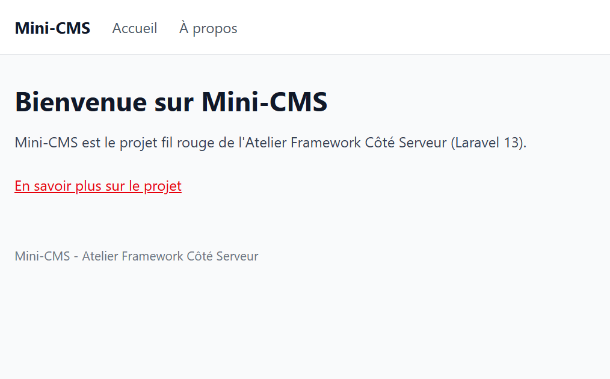
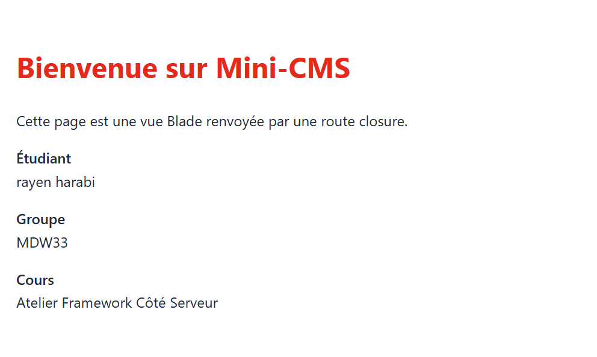
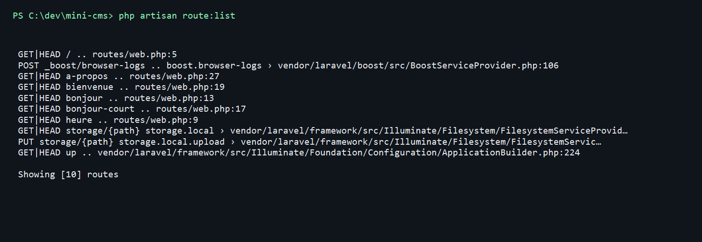
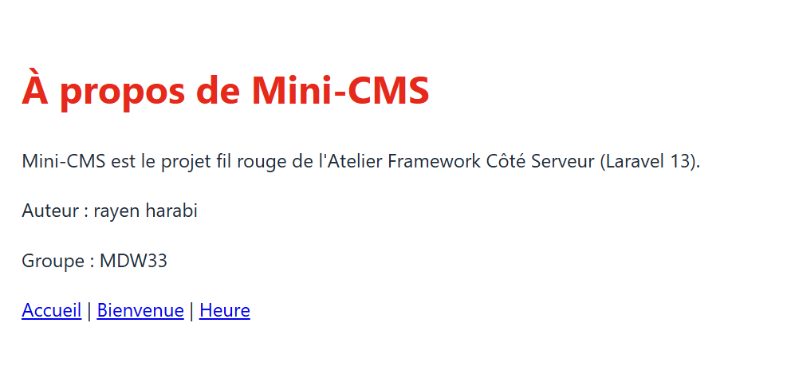

# Mini-CMS

Projet fil rouge de l'Atelier Framework Côté Serveur (Laravel 13, PHP 8.3+), 3e année MDW, ISET Sidi Bouzid.

Auteur : Rayen Harabi, groupe MDW33.

Mini-CMS évoluera au fil du semestre vers une petite plateforme de publication : pages publiques, back-office authentifié, API JSON et tests Pest. Chaque session se termine par un tag Git (`lab-01`, `lab-01b`, puis un tag par session).

## État actuel (session 03)

- Routes : `/`, `/heure` et `/a-propos`.
- Les pages d'accueil et À propos sont servies par `PageController`; `/heure` reste une route closure.
- Vues Blade : `home` et `a-propos` utilisent le composant partagé `x-layout`; la vue `heure` reste autonome.
- Base de données SQLite locale (`database/database.sqlite`, non versionnée).

## Routes disponibles

| Méthode | URI | Réponse |
|---|---|---|
| GET | `/` | Vue `welcome`, servie par `PageController` |
| GET | `/heure` | Vue `heure` avec l'heure (format H:i) et la date (format d/m/Y) |
| GET | `/a-propos` | Vue `a-propos` avec le nom de l'auteur et le groupe, servie par `PageController` |

## Prérequis

- PHP et Composer (PHP 8.3 ou plus depuis https://www.php.net/downloads, avec les extensions curl, fileinfo, mbstring, openssl, pdo_sqlite, sqlite3 et zip activées dans php.ini, et Composer depuis https://getcomposer.org).
- Node.js LTS et npm.
- Git.

## Installation

### Bash (Git Bash, macOS, Linux)

```bash
git clone https://github.com/Lharbi11/mini-cms.git
cd mini-cms
composer install
npm install
cp .env.example .env
php artisan key:generate
touch database/database.sqlite
php artisan migrate
composer run dev
```

### PowerShell (Windows)

```powershell
git clone https://github.com/Lharbi11/mini-cms.git
cd mini-cms
composer install
npm install
copy .env.example .env
php artisan key:generate
New-Item database\database.sqlite -ItemType File
php artisan migrate
composer run dev
```

Ouvrir ensuite http://localhost:8000 (adresse de l'application, différente de l'adresse de Vite sur le port 5173).

L'avant-dernière ligne de chaque bloc d'installation lance les migrations. Cette commande crée les tables internes de Laravel (sessions, cache) ; les migrations sont étudiées en session 05.

## Captures d'écran

### Page d'accueil



### Page Bienvenue



### Liste des routes



### Page À propos


